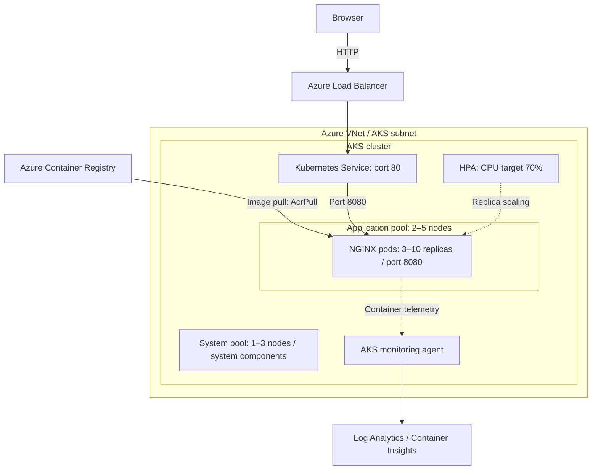
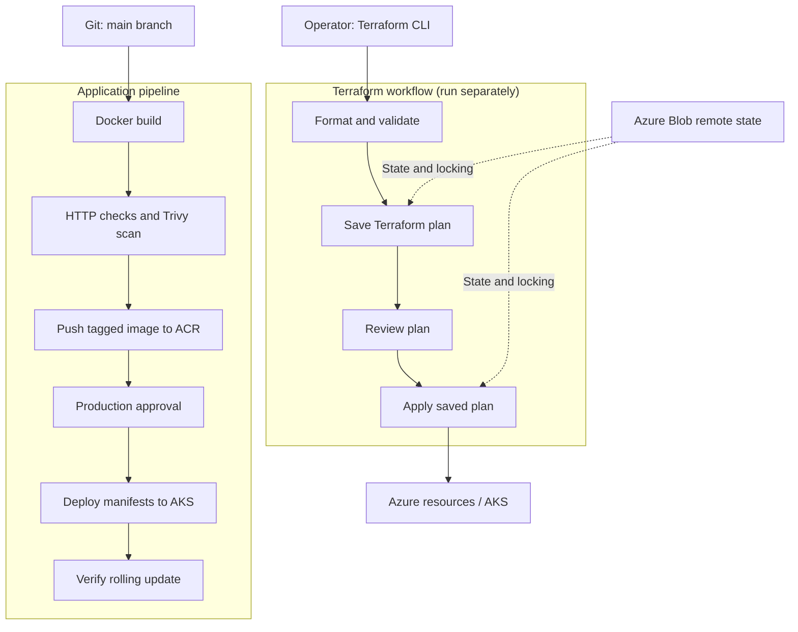

# Azure AKS Web Application Deployment with Terraform and Azure Pipelines

## Deployment screenshots


## Project overview

Deploy a containerized NGINX web application on Azure Kubernetes Service (AKS). Terraform provisions the infrastructure, Azure Container Registry (ACR) stores images, and Azure Pipelines automates application builds and releases.

## Technical stack

| Layer | Technology | Project configuration / purpose |
|---|---|---|
| Cloud | Microsoft Azure | Hosts networking, registry, AKS, state storage, and logs |
| Infrastructure | Terraform | CLI `>= 1.11, < 2.0`; run separately from the application pipeline |
| Azure provider | `hashicorp/azurerm` | Constraint `~> 4.59`; lock file selects `4.81.0` |
| Application | HTML and NGINX | Static page at `/`; health endpoint at `/health` |
| Containers | Docker | Base image `nginx:stable-alpine-slim`; deployments build for Linux AMD64 |
| Registry | Azure Container Registry | Premium SKU; admin account disabled; tagged images |
| Orchestration | Azure Kubernetes Service | Standard tier; separate system and application pools |
| Networking | Azure VNet and Azure CNI Overlay | Dedicated AKS subnet and separate pod/service ranges |
| Traffic | Standard Azure Load Balancer | Public HTTP port 80 routed to container port 8080 |
| Scaling | Kubernetes HPA and AKS cluster autoscaler | CPU-based pod scaling and node capacity scaling |
| Identity | Microsoft Entra ID and Azure RBAC | Managed identities, kubelogin, and pipeline workload identity federation |
| CI/CD | Azure Pipelines | YAML pipelines on `ubuntu-latest`; production environment approvals |
| Image scanning | Trivy | `aquasec/trivy:latest`; blocks fixable HIGH/CRITICAL findings |
| State | Azure Blob Storage | Entra authentication, blob versioning, and seven-day delete retention |
| Monitoring | Log Analytics and Container Insights | AKS monitoring agent; 30-day log retention |
| Source control | Git | Relevant changes on `main` trigger pipelines |

## Objectives

- Provision repeatable Azure infrastructure using Terraform.
- Automate container builds, checks, scanning, and deployment.
- Scale application pods and AKS nodes independently.
- Use identity-based access and approved production deployments.
- Support health monitoring and rolling application updates.

## Implementation plan

| Phase | Work | Result |
|---|---|---|
| 1. Prepare | Configure Azure access, inputs, and remote state | Deployment prerequisites ready |
| 2. Provision | Apply Terraform for networking, ACR, AKS, identities, and logs | Platform ready for workloads |
| 3. Deploy | Build and push the image; apply Kubernetes resources | Application reachable over HTTP |
| 4. Automate and verify | Configure pipelines/approvals; check rollout, scaling, and logs | Repeatable delivery and operations |

## Architecture

| Area | Flow |
|---|---|
| Infrastructure workflow | Terraform format/validate → saved plan → review → apply → Azure |
| Application CI/CD | Git → Docker build → HTTP checks → Trivy scan → ACR → approval → AKS rollout |
| Application traffic | Browser → Azure Load Balancer → Service port 80 → NGINX pods on port 8080 |
| Monitoring | AKS monitoring agent → Log Analytics → Container Insights |

AKS uses Azure CNI Overlay within a VNet. System components use the system pool; application pods select the dedicated application pool. The kubelet pulls images using AcrPull. Remote state is stored in a separately bootstrapped Azure Storage account.

### Runtime architecture



### CI/CD architecture



Run Terraform provisioning before the first application deployment. The included Azure pipeline builds and deploys the application; configure its approval checks on the Azure DevOps `production` environment.

## Repository structure

| Directory | Contents |
|---|---|
| [app/](app/) | HTML page, NGINX configuration, Dockerfile |
| [terraform/](terraform/) | Infrastructure, variables, outputs, backend examples, provider lock file |
| [kubernetes/](kubernetes/) | Namespace, Deployment, LoadBalancer Service, HPA |
| [azure-pipelines.yml](azure-pipelines.yml) | Application build, health checks, vulnerability scan, ACR push, and AKS deployment |
| [scripts/](scripts/) | State bootstrap, manual application deployment, CI Terraform execution |

## Key settings

| Setting | Default |
|---|---|
| Region / resource group | `centralindia` / `rg-aks-production` |
| AKS / ACR | `aks-production`, Standard tier / Premium registry |
| Networking | VNet `10.0.0.0/16`; subnet `10.0.1.0/24`; pods `10.244.0.0/16`; services `10.10.0.0/16` |
| Node pools | System: 1–3 nodes; application: 2–5 nodes; both use `Standard_D2s_v5` |
| Application scaling | Initially 3 replicas; HPA: 3–10 replicas at 70% requested CPU utilization |
| Pod resources | CPU: `100m` request / `500m` limit; memory: `128Mi` request / `256Mi` limit |
| Updates / health | RollingUpdate: 0 unavailable, 1 surge; `/health` readiness and liveness probes |
| Logs | Log Analytics with 30-day retention |
| Terraform | CLI `>= 1.11, < 2.0`; AzureRM lock file selects `4.81.0` |

## Prerequisites

Run the commands below in Bash from the repository root, the directory containing `azure-pipelines.yml`. Replace `YOUR...` placeholders before running them.

Install Azure CLI, Terraform `>= 1.11, < 2.0`, Docker, kubectl, kubelogin, Git, Bash, and curl. Start Docker Desktop or the Docker daemon before building images. Docker Compose is not required.

```bash
cd terraform-aks-webapp-deployment

az version
terraform version
docker version
kubectl version --client
kubelogin --version
git --version
bash --version
curl --version
```

If your terminal is already in the repository root, skip the `cd` command.

| Identity | Required access |
|---|---|
| Operator provisioning infrastructure | Contributor and Role Based Access Control Administrator at the subscription or relevant resource scopes; available regional VM quota |
| Terraform state user | Storage Blob Data Contributor on the state account; the bootstrap script grants this to the signed-in user |
| Application publisher | ACR read access and AcrPush or equivalent permissions |
| AKS operator / application pipeline | AKS read access, Azure Kubernetes Service Cluster User Role, and Azure Kubernetes Service RBAC Cluster Admin; Terraform grants the AKS roles to `admin_principal_ids` |

## Run the application locally

This optional step runs NGINX on your computer without Azure resources. The local build uses your computer's architecture; the Azure deployment script and pipeline build Linux AMD64 images for the configured AKS nodes.

```bash
docker build --pull --tag aks-webapp:local ./app

docker run -d --name aks-webapp \
  --read-only --tmpfs /tmp:uid=101,gid=101 \
  -p 127.0.0.1:8080:8080 aks-webapp:local

curl --fail --retry 10 --retry-delay 2 --retry-connrefused \
  http://127.0.0.1:8080/health
curl --fail http://127.0.0.1:8080/
```

Open `http://localhost:8080`. The `/health` endpoint returns HTTP `200` with body `healthy` and `Cache-Control: no-store`.

To inspect or stop the local container:

```bash
docker logs aks-webapp
docker rm -f aks-webapp
```

Remove the old container before repeating `docker run` with the same name. Rebuild after changing files in `app/`.

## Deploy to Azure

Complete steps 1–6 in order. These commands create the state storage, provision the platform, and deploy the application.

### 1. Sign in and select the subscription

```bash
az login
az account set --subscription "YOUR-SUBSCRIPTION-ID"
az account show --query '{name:name,id:id,tenantId:tenantId}' --output table
az ad signed-in-user show --query id --output tsv
```

Use the selected subscription ID and your Entra user object ID in the next step. The bootstrap script uses the selected Azure CLI subscription. When signing in as a service principal instead of a user, set `TFSTATE_PRINCIPAL_ID` to that principal's object ID before running the bootstrap script.

### 2. Configure Terraform inputs

For a new checkout, copy the input example. If `terraform/terraform.tfvars` already exists, edit that file instead of copying over it.

```bash
cp terraform/terraform.tfvars.example terraform/terraform.tfvars
```

Edit `terraform/terraform.tfvars` with your values:

```hcl
subscription_id     = "YOUR-SUBSCRIPTION-ID"
location            = "centralindia"
resource_group_name = "rg-aks-production"
aks_name            = "aks-production"
acr_name            = "YOURUNIQUEACRNAME"
vnet_name           = "vnet-aks-production"

admin_principal_ids = ["YOUR-ENTRA-USER-OBJECT-ID"]
```

Choose an available ACR name containing 5–50 alphanumeric characters. Use `atulkamble` only if it is available for this deployment; otherwise choose your own name and update the pipeline's `acrName` later. The manual deploy script reads the actual registry from Terraform outputs.

Add the application pipeline's service principal **object ID** to `admin_principal_ids` when available. Use object IDs, not application/client IDs. To use a different node size, add `node_vm_size = "YOUR-VM-SIZE"` to the file. Keep the selected Azure CLI subscription consistent with `subscription_id`.

### 3. Create remote state storage

For the first deployment, run:

```bash
bash scripts/bootstrap-state.sh
cat terraform/backend.hcl
```

The script generates an available random name such as `staks0123456789abcdef`, creates the storage account in `rg-tfstate-prod` in `centralindia`, grants state access to the bootstrap principal, and creates the `tfstate` container. It enables blob versioning and seven-day delete retention, then writes `terraform/backend.hcl` with the generated name and state key `production.aks.tfstate`.

To customize the state resource group or region, use this command **instead of** the default bootstrap command:

```bash
TFSTATE_RESOURCE_GROUP="rg-tfstate-prod" \
TFSTATE_LOCATION="centralindia" \
  bash scripts/bootstrap-state.sh
```

An explicit name remains optional: set `TFSTATE_STORAGE_ACCOUNT` when invoking the script if you want to choose it yourself. The script waits for new storage role assignments to propagate.

On subsequent runs, keep `terraform/backend.hcl` and proceed to step 4. The bootstrap script refuses to overwrite an existing backend file. For an existing state account, copy [terraform/backend.hcl.example](terraform/backend.hcl.example) to `terraform/backend.hcl` and set its values to that account, container, and existing state key. The current Terraform identity needs access to that container.

### 4. Initialize, review, and apply Terraform

```bash
terraform -chdir=terraform fmt -check -recursive
terraform -chdir=terraform init -backend-config=backend.hcl
terraform -chdir=terraform validate
terraform -chdir=terraform plan -out=tfplan
terraform -chdir=terraform show -no-color tfplan
```

Review the saved plan, then apply it:

```bash
terraform -chdir=terraform apply tfplan
terraform -chdir=terraform output
```

Terraform creates the resource group, networking, ACR, AKS, node pools, identities, role assignments, and Log Analytics workspace. Allow role assignments time to propagate before deploying the application.

Read the values used by the deployment scripts and pipeline:

```bash
terraform -chdir=terraform output -raw resource_group_name
terraform -chdir=terraform output -raw aks_name
terraform -chdir=terraform output -raw acr_name
terraform -chdir=terraform output -raw acr_login_server
```

If `fmt -check` reports formatting changes, run `terraform -chdir=terraform fmt -recursive`, then repeat validation and planning. Commit the provider lock file. Local variables, backend settings, state, and saved plans are ignored by Git.

### 5. Build, push, and deploy the application

Ensure your signed-in publishing identity has ACR read access and `AcrPush` or equivalent access to the registry. If it needs an explicit push grant, an operator with role assignment permissions can run:

```bash
acr_name="$(terraform -chdir=terraform output -raw acr_name)"
acr_id="$(az acr show --name "$acr_name" --query id --output tsv)"
operator_object_id="$(az ad signed-in-user show --query id --output tsv)"

az role assignment create \
  --assignee-object-id "$operator_object_id" \
  --assignee-principal-type User \
  --role AcrPush --scope "$acr_id" --output none
```

After permissions have propagated, deploy from the repository root:

```bash
bash scripts/deploy-app.sh v1
```

The script reads Terraform outputs, logs in to ACR, builds and pushes `<acr-login-server>/webapp:v1`, gets AKS credentials, and configures kubelogin. It creates the namespace first, substitutes the actual image into the Deployment in memory, applies the Deployment, Service, and HPA, and waits for the rollout. It does not rewrite the image line in the checked-in YAML.

The checked-in Deployment uses `atulkamble.azurecr.io/webapp:v1` as its default. Use the script to deploy to your own ACR and select the correct tag automatically.

### 6. Verify the deployment and open the application

```bash
kubectl get nodes
kubectl get pods,svc,hpa -n production
kubectl rollout status deployment/webapp -n production --timeout=300s
kubectl get service webapp-service -n production
```

Wait until the Service's `EXTERNAL-IP` is assigned, then run:

```bash
app_ip="$(kubectl get service webapp-service -n production \
  -o jsonpath='{.status.loadBalancer.ingress[0].ip}')"
curl --fail "http://$app_ip/health"
printf 'Open http://%s\n' "$app_ip"
```

Check the pushed image and available tags:

```bash
acr_name="$(terraform -chdir=terraform output -raw acr_name)"
az acr repository list --name "$acr_name" --output table
az acr repository show-tags --name "$acr_name" --repository webapp --output table
```

The tag listing command is documented in the [Azure CLI ACR reference](https://learn.microsoft.com/en-us/cli/azure/acr/repository?view=azure-cli-latest#az-acr-repository-show-tags).

## Run with Azure Pipelines

The application pipeline is [azure-pipelines.yml](azure-pipelines.yml). Complete Terraform provisioning first; this pipeline builds and deploys the application to the existing platform.

### 1. Configure the service connection and access

In Azure DevOps, go to **Project settings → Service connections → New service connection → Azure Resource Manager**. Create a connection named `project`, preferably using workload identity federation, and authorize this pipeline to use it.

Add its service principal object ID to `admin_principal_ids` in `terraform/terraform.tfvars`, alongside your operator object ID, and apply a reviewed Terraform plan again if the platform already exists. Terraform assigns the AKS Cluster User and AKS RBAC Cluster Admin roles to these principals and assigns `AcrPull` to the kubelet identity separately.

An operator with role assignment permissions can grant the pipeline read access to the project resource group and push access to ACR:

```bash
pipeline_object_id="YOUR-SERVICE-CONNECTION-OBJECT-ID"
resource_group="$(terraform -chdir=terraform output -raw resource_group_name)"
resource_group_id="$(az group show --name "$resource_group" --query id --output tsv)"
acr_name="$(terraform -chdir=terraform output -raw acr_name)"
acr_id="$(az acr show --name "$acr_name" --query id --output tsv)"

az role assignment create \
  --assignee-object-id "$pipeline_object_id" \
  --assignee-principal-type ServicePrincipal \
  --role Reader --scope "$resource_group_id" --output none

az role assignment create \
  --assignee-object-id "$pipeline_object_id" \
  --assignee-principal-type ServicePrincipal \
  --role AcrPush --scope "$acr_id" --output none
```

Use the identity behind the Azure Resource Manager service connection, not a Kubernetes service connection. Role assignment arguments are documented in the [Azure CLI role assignment reference](https://learn.microsoft.com/en-us/cli/azure/role/assignment?view=azure-cli-latest#az-role-assignment-create).

### 2. Match the pipeline variables to Terraform

Edit the variables at the top of `azure-pipelines.yml` to match your Terraform outputs:

```yaml
variables:
  azureServiceConnection: project
  resourceGroup: rg-aks-production
  aksClusterName: aks-production
  acrName: atulkamble
  imageRepository: webapp
  imageTag: '$(Build.BuildId)'
```

Replace `acrName` if you provisioned a different registry. Keep `imageRepository: webapp` to match the manual deployment script. The pipeline queries the registry's login server and tags each image with the Azure DevOps build ID.

### 3. Create the production environment and pipeline

1. Go to **Pipelines → Environments → New environment** and create `production` with resource type **None**; the YAML authenticates to AKS through Azure CLI.
2. Configure approvers and an exclusive lock check on that environment as needed, and authorize the pipeline to deploy to it. See [Microsoft's environment documentation](https://learn.microsoft.com/en-us/azure/devops/pipelines/process/environments?view=azure-devops).
3. Go to **Pipelines → New pipeline**, select your repository, choose **Existing Azure Pipelines YAML file**, and select `/azure-pipelines.yml` on `main`.
4. Save the pipeline, select **Run pipeline**, and run against `main`. Approve the production deployment if an approval check is configured.

For later releases, push changes under `app/`, `kubernetes/`, or to `azure-pipelines.yml` on `main`, or use **Run pipeline** again. README-only and Terraform-only changes do not trigger this application pipeline.

Optionally queue an already-created pipeline using the [Azure DevOps CLI](https://learn.microsoft.com/en-us/azure/devops/pipelines/get-started/manage-pipelines-with-azure-cli?view=azure-devops):

```bash
az extension add --name azure-devops
az devops configure --defaults \
  organization="https://dev.azure.com/YOUR-ORGANIZATION" \
  project="YOUR-AZURE-DEVOPS-PROJECT"
az pipelines run --name "YOUR-PIPELINE-NAME" --branch main --output table
```

### 4. Check the pipeline result

| Stage | Expected result |
|---|---|
| Build | Linux AMD64 image built; `/health` and `/` checked in a read-only container; Trivy blocks fixable HIGH/CRITICAL vulnerabilities; image pushed to ACR |
| Release artifact | `release` artifact contains the Kubernetes manifests and `image.txt` with the exact pushed image reference |
| Deploy | Production environment checks satisfied; namespace applied first; artifact image substituted; Service and HPA applied; rollout completes within five minutes |

Deployment runs only after a successful build from `main` and excludes pull requests. The deployment task installs kubectl matching the AKS version and kubelogin in a writable agent directory. AKS authentication and all kubectl commands run in the same authenticated Azure CLI task. A rollout failure prints pod and Deployment diagnostics and fails the job.

### Terraform CI helper

`scripts/terraform-ci.sh` is a helper for a separately configured Terraform pipeline; the included application pipeline does not call it. Run it inside an `AzureCLI@2` task with `addSpnToEnvironment: true`, `AZURESUBSCRIPTION_SERVICE_CONNECTION_ID` set to the service connection GUID, and `System.AccessToken` mapped to `ARM_OIDC_REQUEST_TOKEN`. Terraform must already be installed.

For a fresh agent, set `TFSTATE_RESOURCE_GROUP`, `TFSTATE_STORAGE_ACCOUNT`, `TFSTATE_CONTAINER`, and `TFSTATE_KEY` to the values saved in `terraform/backend.hcl`. Supply the other Terraform inputs through a generated variables file or `TF_VAR_*` environment variables. The helper exports the subscription ID itself. Its commands are:

```bash
bash scripts/terraform-ci.sh plan
# In the apply task, after downloading and reviewing the saved plan:
PLAN_PATH="/path/to/downloaded/tfplan" bash scripts/terraform-ci.sh apply
```

When present, the helper reads `terraform/backend.hcl`; explicit state environment variables override it. Reuse the same state account and key for plan and apply. The backend file is ignored by Git and will not be present automatically on a fresh agent.

## Updates, troubleshooting, and cleanup

### Release another application version

```bash
bash scripts/deploy-app.sh v2
kubectl rollout status deployment/webapp -n production --timeout=300s
kubectl get pods,svc,hpa -n production
```

Use a new tag for each manual release. Pipeline releases use their build ID as the tag and run HTTP checks and vulnerability scanning before pushing.

### Diagnose a failed deployment

```bash
kubectl get pods -n production -o wide
kubectl describe deployment webapp -n production
kubectl get events -n production --sort-by=.metadata.creationTimestamp
kubectl logs -n production deployment/webapp --tail=100
```

For `ImagePullBackOff`, verify that the selected image tag exists in ACR and that the kubelet has `AcrPull`. For authorization failures, check the operator or pipeline object ID and allow new role assignments time to propagate. For pending nodes or Terraform capacity errors, check VM quota and availability for the chosen size and region. If the pipeline scan fails, review its Trivy findings and rebuild with a fixed base image before releasing.

### Roll back the application

```bash
kubectl rollout undo deployment/webapp -n production
kubectl rollout status deployment/webapp -n production --timeout=300s
```

A rollback requires an earlier Deployment revision. Align the next manual or pipeline release with the intended application version.

### Remove deployed infrastructure

These commands delete the Terraform-managed AKS cluster, registry and its images, networking, and monitoring resources. First review the destroy plan:

```bash
terraform -chdir=terraform plan -destroy -out=destroy.tfplan
terraform -chdir=terraform show -no-color destroy.tfplan
```

After reviewing it, apply the saved destroy plan:

```bash
terraform -chdir=terraform apply destroy.tfplan
```

The separately bootstrapped state storage account is retained. Keep its backend settings if you plan to reuse it. To remove only the optional local test container, use `docker rm -f aks-webapp`.

## Scope

The current endpoint uses public HTTP. TLS, ingress, private endpoints, Key Vault integration, availability zones, Pod Disruption Budgets, and custom alerts are future enhancements. AKS workload identity is enabled, but application identity bindings are not configured. The one-node system-pool minimum does not provide node redundancy for system components.

## Conclusion

The project provides a repeatable workflow from Terraform provisioning to container delivery on AKS, with autoscaling, identity-based access, approved releases, health checks, and centralized logging.

**License:** [MIT](LICENSE) · **Author:** Atul Kamble